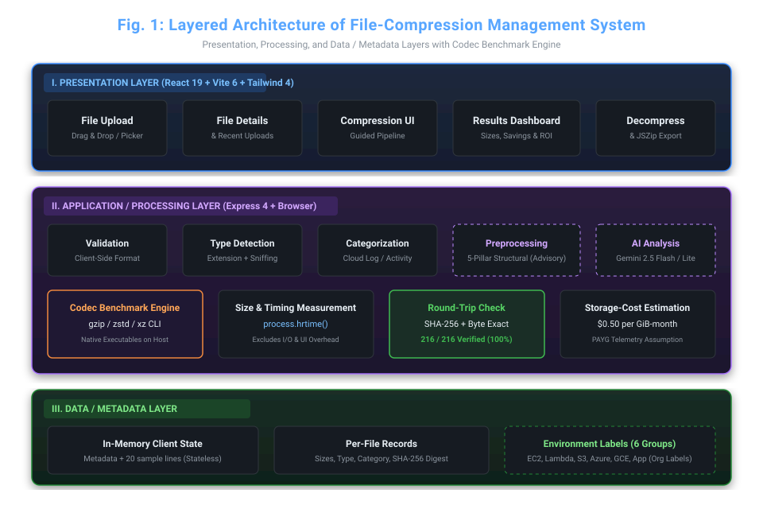
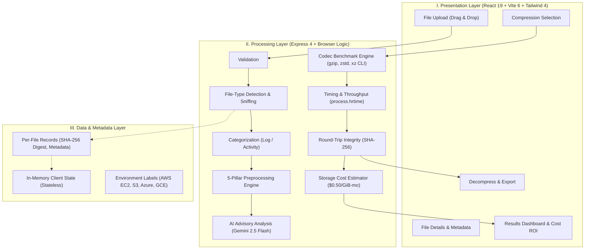
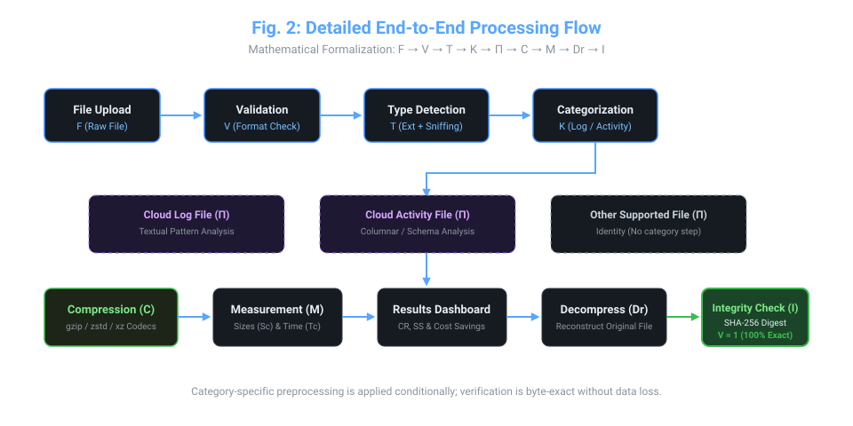
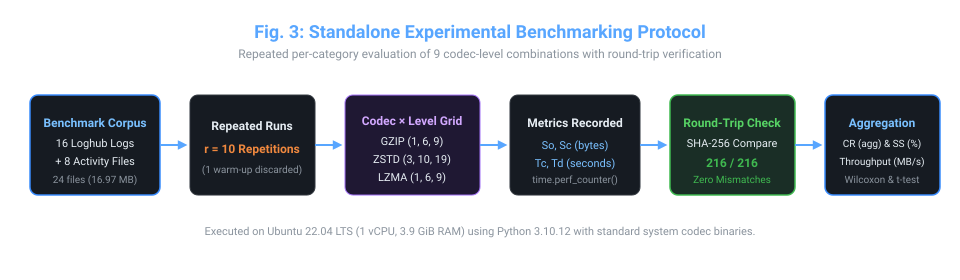
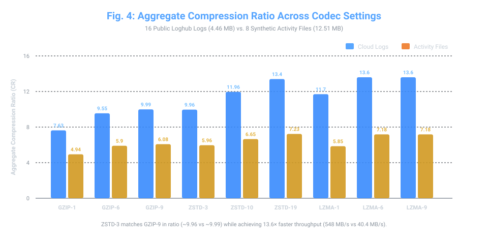
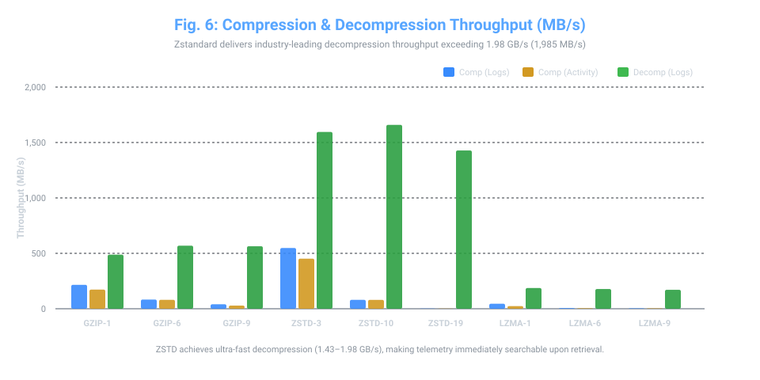
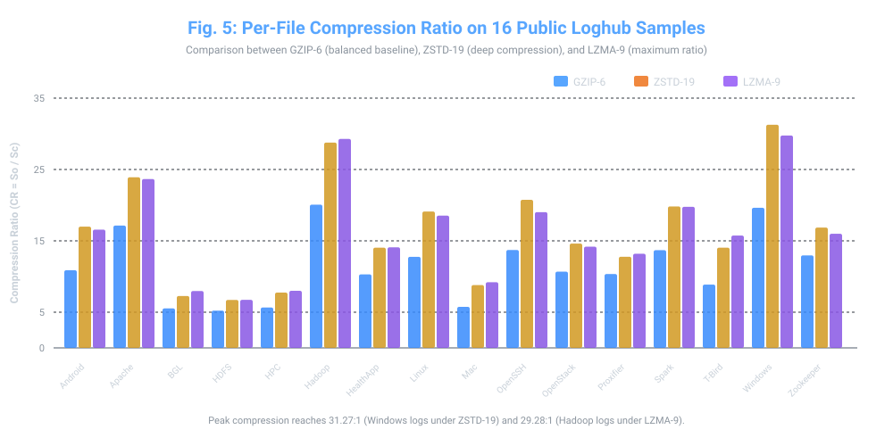
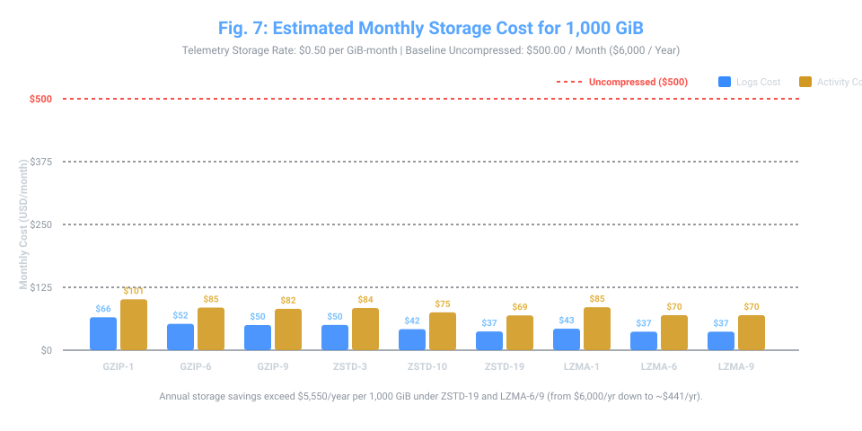

# AI-Based Log File Compression for Cloud Systems

[](paper/AI_Based_Log_File_Compression_for_Cloud_Systems.pdf)
[](docs/BENCHMARK_RESULTS.md)
[](docs/BENCHMARK_RESULTS.md)
[](LICENSE)

> **Research Paper Authors:**  
> **Ramya B**, **Ameen Basha M**, and **Dr. Karthik K**  
> *School of Computer Science and Engineering (SCOPE), Vellore Institute of Technology (VIT), Vellore, Tamil Nadu, India*  
> 📧 `ramya.b2023@vitstudent.ac.in` | `ameenbasha.m2023@vitstudent.ac.in` | `k.karthik@vit.ac.in`  
> 📄 **Download Paper:** [`paper/AI_Based_Log_File_Compression_for_Cloud_Systems.pdf`](paper/AI_Based_Log_File_Compression_for_Cloud_Systems.pdf)

---

## 📌 Abstract & Overview

Cloud computing platforms collect massive volumes of telemetry data—including application logs, server telemetry, and structured cloud activity trails. Storing this retained data incurs usage-based cloud storage costs. While lossless compression is essential for compliance and troubleshooting, selecting the optimal codec and configuration involves complex trade-offs between compression ratio, compression throughput, and decompression speed.

This project implements an end-to-end **Cloud-Based File-Compression Management System** that:
1. **Validates & Detects File Types**: Ingests files, sniffs content structure, and categorizes them into **Cloud Log Files** (semi-structured text) and **Cloud Activity Files** (structured tabular JSON/CSV).
2. **Applies Preprocessing Analysis**: Structural deduplication and redundancy scoring.
3. **Executes Compression Benchmarks**: Measures real compression and decompression using native host engines (`gzip`, `zstd`, `xz`).
4. **Verifies 100% Round-Trip Integrity**: Ensures byte-for-byte fidelity with cryptographic SHA-256 checks.
5. **Estimates Storage Cost Impact**: Quantifies monthly and annual cloud storage cost reductions ($0.50/GiB-month telemetry baseline).
6. **Features an Interactive Dashboard**: Developed with React 19, TypeScript, Tailwind CSS 4, Express 4, and Google Gemini AI integration.

---

## 🏛️ System Architecture

The management system follows a three-tier architecture: **Presentation Layer**, **Application / Processing Layer**, and **Data / Metadata Layer**.





---

## 🔄 End-to-End Processing Flow

The workflow is formalized by the mathematical pipeline equation:

$$\mathbf{F \longrightarrow V \longrightarrow T \longrightarrow K \longrightarrow \Pi \longrightarrow C \longrightarrow M \longrightarrow D_r \longrightarrow I}$$

Where:
- $F$: Uploaded raw file
- $V$: File format validation
- $T$: Automatic file-type detection (content sniffing + extension)
- $K$: Categorization into *Cloud Log File* or *Cloud Activity File*
- $\Pi$: Preprocessing analysis
- $C$: Compression via selected codec (`gzip`, `zstd`, `xz`)
- $M$: Measurement of compressed size ($S_c$) and duration ($T_c$)
- $D_r$: Decompression to reconstructed file ($F'$)
- $I$: Cryptographic integrity verification ($V(F, F') = 1$)



---

## 🧪 Experimental Benchmarking Protocol

A standalone evaluation harness tested **216 total benchmark configurations** (24 datasets $\times$ 9 codec-level combinations) over repeated iterations ($r = 10$) on an isolated Linux environment (Ubuntu 22.04 LTS, 1 vCPU, 3.9 GiB RAM):



### Evaluated Codec Grid:
- **GZIP (DEFLATE)**: Levels 1, 6, 9
- **Zstandard (ZSTD)**: Levels 3, 10, 19
- **LZMA (XZ Utils)**: Levels 1, 6, 9

---

## 📊 Benchmark Results & Key Findings

For complete tables and statistical tests, see [`docs/BENCHMARK_RESULTS.md`](docs/BENCHMARK_RESULTS.md).

### 1. Compression Ratio Comparison
- **Cloud Log Files (16 Loghub samples, 4.46 MB)**:
  - Aggregate compression ratio ranged from **7.63** (GZIP-1) to **13.60** (LZMA-6 / LZMA-9), saving **86.9% to 92.6%** of storage space.
  - Peak compression ratio achieved was **31.27:1** on Windows log samples under ZSTD-19.
- **Cloud Activity Files (8 Synthetic JSON/CSV, 12.51 MB)**:
  - Aggregate ratio ranged from **4.94** (GZIP-1) to **7.23** (ZSTD-19).



### 2. Throughput & Speed Trade-Offs
- **ZSTD-3 achieved 548.0 MB/s** on log files, matching the compression ratio of GZIP-9 (~9.96 vs ~9.99) while running **13.6× faster**.
- **Ultra-Fast Decompression**: Zstandard decompressed at **1,428–1,985 MB/s** (up to **1.98 GB/s**), an order of magnitude faster than LZMA (95–187 MB/s). This is critical for real-time cloud log queries.



### 3. Per-File Compression Ratios Across 16 Public Loghub Datasets



### 4. 100% Round-Trip Integrity Verification
Across all **216 evaluations**, every single reconstructed file produced an identical byte-for-byte SHA-256 match ($V(F, F') = 1$ with **0 mismatches or corruption**).

---

## 💰 Cloud Storage Cost Impact Analysis

Assuming a standard telemetry storage rate of **$0.50 per GiB-month** ($1\text{ GiB} = 2^{30}\text{ bytes}$), an uncompressed baseline volume of 1,000 GiB costs **$500.00/month** ($6,000/year):



| Codec Setting | Monthly Cost (Logs) | Monthly Savings (Logs) | Annual Savings (Logs) | Space Saved (%) |
|:---|:---:|:---:|:---:|:---:|
| **Uncompressed Baseline** | $500.00 | $0.00 | $0.00 | 0.0% |
| **GZIP-1** | $65.53 | $434.47 | $5,213.64 | 86.9% |
| **GZIP-6** | $52.36 | $447.64 | $5,371.68 | 89.5% |
| **GZIP-9** | $50.05 | $449.95 | $5,399.40 | 90.0% |
| **ZSTD-3** | $50.20 | $449.80 | $5,397.60 | 90.0% |
| **ZSTD-10**| $41.81 | $458.19 | $5,498.28 | 91.6% |
| **ZSTD-19**| $37.31 | **$462.69** | **$5,552.28** | 92.5% |
| **LZMA-6 / 9** | **$36.76** | **$463.24** | **$5,558.88** | **92.6%** |

---

## 🔬 Comparison with Prior State-of-the-Art

Comparison against **Wei et al. (USENIX FAST 2021)** (*On the Feasibility of Parser-based Log Compression in Large-Scale Cloud Systems*):

| Metric | This Work (AI-Based Cloud Compression) | Wei et al. (*LogReducer*, FAST '21) [35] |
|:---|:---|:---|
| **Evaluated Formats** | Cloud Log Files & Structured Cloud Activity Files | Cloud Log Files only |
| **Evaluated Codecs** | GZIP (1,6,9), ZSTD (3,10,19), LZMA (1,6,9) | gzip, LZMA, LogArchive, Logzip, LogReducer |
| **Decompression Speed**| **Measured: 171–1,985 MB/s (up to 1.98 GB/s)** | *Not Reported* |
| **Round-Trip Integrity**| **216 / 216 verified byte-exact (SHA-256)** | *Not Reported* |
| **Compression Speed**| **Up to 548.0 MB/s** | 3.77–10.72 MB/s |
| **Storage ROI Model** | Detailed monthly and annualized cost savings | Compression ratio only |

---

## 🚀 Running the Web Application Locally

### Prerequisites
- [Node.js](https://nodejs.org/) (v18 or higher; tested on v24)
- (Optional) Native compression tools in your PATH: `gzip`, `zstd`, `xz`

### Installation & Launch

1. **Clone the repository:**
   ```bash
   git clone https://github.com/ramyachoww/ai-cloud-log-compression.git
   cd ai-cloud-log-compression
   ```

2. **Install dependencies:**
   ```bash
   npm install
   ```

3. **Configure environment variables (optional for AI features):**
   ```bash
   cp .env.example .env
   ```
   *Add your Gemini API Key in `.env` if you wish to enable live AI suggestions:*
   ```env
   GEMINI_API_KEY="your-gemini-api-key-here"
   ```

4. **Start the application:**
   ```bash
   npm run dev
   ```

5. Open your browser at **[http://localhost:3000](http://localhost:3000)**.

---

## 📁 Repository Structure

```
ai-cloud-log-compression/
├── paper/
│   └── AI_Based_Log_File_Compression_for_Cloud_Systems.pdf  # Full research paper PDF
├── docs/
│   ├── BENCHMARK_RESULTS.md                                # Comprehensive benchmark tables & statistics
│   └── images/                                             # High-resolution architectural & benchmark figures
│       ├── fig1-architecture.svg
│       ├── fig2-processing-flow.svg
│       ├── fig3-experimental-protocol.svg
│       ├── fig4-compression-performance.svg
│       ├── fig5-per-file-compression-ratio.svg
│       ├── fig6-speed-vs-space.svg
│       └── fig7-storage-cost.svg
├── scripts/
│   └── generate_diagrams.cjs                               # Vector diagram generator
├── src/
│   ├── components/
│   │   ├── BenchmarkResultsView.tsx                        # Live benchmark execution view
│   │   ├── CompressionWorkbenchView.tsx                    # Codec workbench
│   │   ├── DashboardView.tsx                               # Interactive dashboard & telemetry stats
│   │   ├── StorageCostRoiChart.tsx                         # ROI & storage cost chart
│   │   ├── PreprocessingView.tsx                           # 5-Pillar structural preprocessing
│   │   ├── DecompressionVerifyView.tsx                     # Round-trip verification UI
│   │   └── AIAnalysisView.tsx                              # Gemini AI suggestions view
│   ├── data/                                               # Static telemetry & benchmark dataset models
│   ├── utils/                                              # Preprocessing engine, audit export & formatters
│   ├── App.tsx                                             # Main React SPA
│   └── main.tsx
├── server.ts                                               # Express backend (real benchmark & Gemini proxy)
├── vite.config.ts
└── package.json
```

---

## 📚 Citation

If you find this research or code useful in your academic work, please cite:

```bibtex
@article{ramya2026logcompression,
  title={AI-Based Log File Compression for Cloud Systems},
  author={Ramya, B. and Ameen Basha, M. and Karthik, K.},
  journal={School of Computer Science and Engineering (SCOPE), Vellore Institute of Technology (VIT)},
  year={2026},
  address={Vellore, Tamil Nadu, India}
}
```
