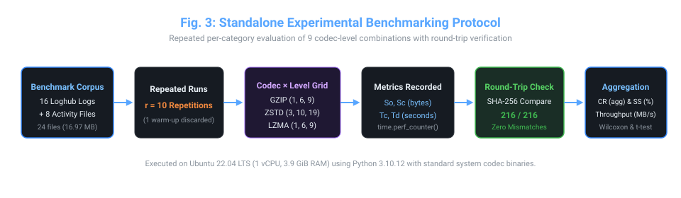
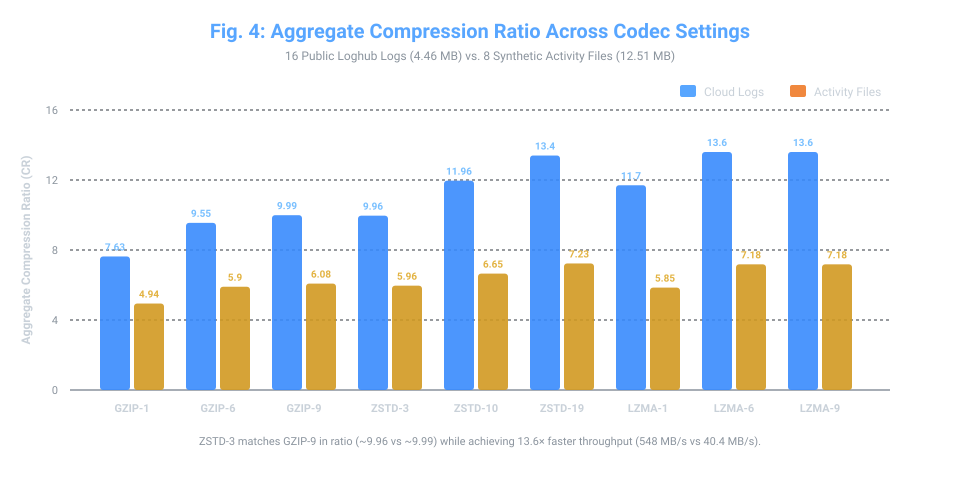
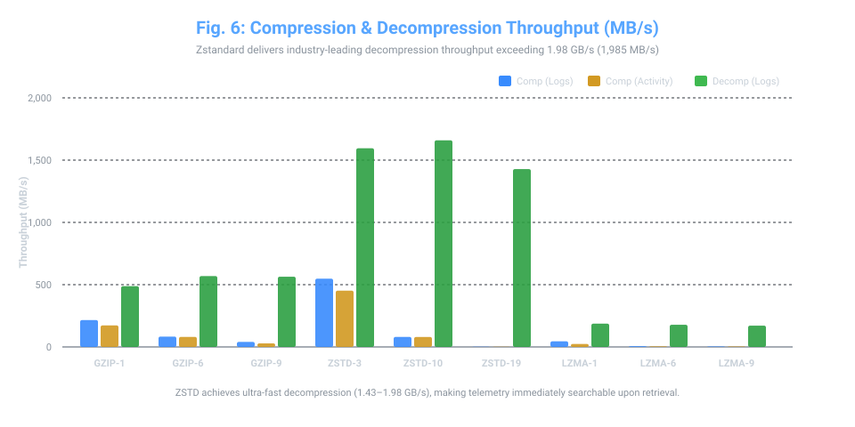
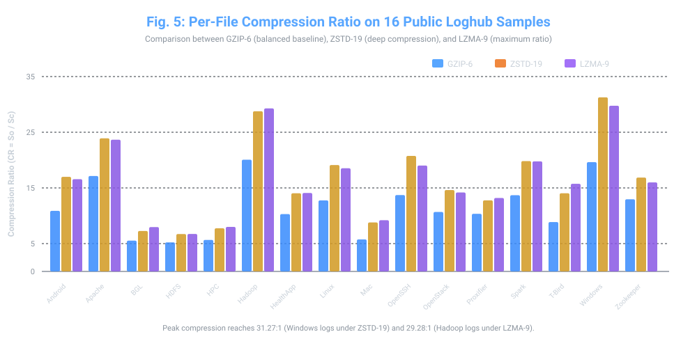
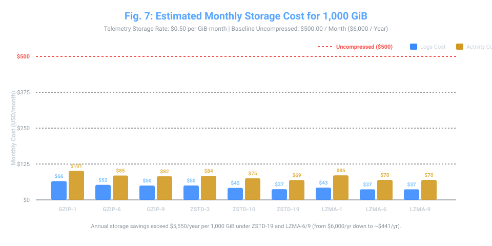

# Comprehensive Benchmark Results & Experimental Analysis

> **Companion Research Documentation for:**  
> **"AI-Based Log File Compression for Cloud Systems"**  
> *Ramya B, Ameen Basha M, and Dr. Karthik K*  
> *School of Computer Science and Engineering (SCOPE), Vellore Institute of Technology (VIT), Vellore, India*  
> 📄 **Full Paper PDF:** [`paper/AI_Based_Log_File_Compression_for_Cloud_Systems.pdf`](../paper/AI_Based_Log_File_Compression_for_Cloud_Systems.pdf)

---

## 1. Experimental Protocol & Test Configuration

All benchmarks were evaluated using a standalone, automated evaluation harness under strictly controlled conditions.

### Table V: Testbed Hardware & Software Specification
| Parameter | Value / Specification |
|:---|:---|
| **Platform / CPU** | 1 vCPU, 3.9 GiB RAM (virtualized) |
| **Operating System** | Linux (Ubuntu 22.04 LTS kernel) |
| **Python Environment** | Python 3.10.12 |
| **`gzip` Executable** | System binary 1.10 (DEFLATE levels 1, 6, 9) |
| **`zstd` Executable** | System binary 1.4.8 (levels 3, 10, 19) |
| **`xz` Executable** | System binary 5.2.5 (LZMA levels 1, 6, 9) |
| **Repetitions** | 10 timed iterations per file and setting (1 warm-up discarded) |
| **Timer** | `time.perf_counter()` (monotonic nanosecond clock) |
| **Integrity Verification** | SHA-256 byte-by-byte digest comparison ($V = 1$) |

---

## 2. Dataset Characteristics

### Table VI: Evaluated Dataset Summary
| Category | File Count | Total Size | Description / Source |
|:---|:---:|:---:|:---|
| **Cloud Log Files** | 16 | 4.46 MB | Public Loghub collection (2,000-line samples): Android, Apache, BGL, HDFS, HPC, Hadoop, HealthApp, Linux, Mac, OpenSSH, OpenStack, Proxifier, Spark, Thunderbird, Windows, Zookeeper |
| **Cloud Activity Files** | 8 | 12.51 MB | Synthetic structured activity records: 4 flat CSV exports (370–1,480 KB) and 4 CloudTrail-style JSON exports (1,019–4,079 KB) |
| **Total** | **24** | **16.97 MB** | **216 total benchmark evaluations** |

---

## 3. Cloud Log Files Compression Results

### Table VII: Standalone Benchmark Results (16 Public Loghub Samples)
| Codec | $\Sigma$ Orig (MB) | $\Sigma$ Comp (MB) | Saved (MB) | CR (agg) | CR Mean $\pm$ 95% CI | Space Saved (%) | Throughput $\Theta_c$ (MB/s) | Timing $CV_c$ (%) |
|:---|:---:|:---:|:---:|:---:|:---:|:---:|:---:|:---:|
| **GZIP-1** | 4.46 | 0.58 | 3.87 | **7.63** | $9.03 \pm 1.97$ | 86.9% | 215.9 MB/s | 9.2% |
| **GZIP-6** | 4.46 | 0.47 | 3.99 | **9.55** | $11.45 \pm 2.53$ | 89.5% | 83.1 MB/s | 6.5% |
| **GZIP-9** | 4.46 | 0.45 | 4.01 | **9.99** | $12.23 \pm 2.81$ | 90.0% | 40.4 MB/s | 8.1% |
| **ZSTD-3** | 4.46 | 0.45 | 4.01 | **9.96** | $11.99 \pm 2.86$ | 90.0% | **548.0 MB/s** | 13.6% |
| **ZSTD-10**| 4.46 | 0.37 | 4.09 | **11.96**| $14.75 \pm 3.58$ | 91.6% | 80.4 MB/s | 10.8% |
| **ZSTD-19**| 4.46 | 0.33 | 4.13 | **13.40**| $16.47 \pm 3.91$ | 92.5% | 2.0 MB/s | 8.3% |
| **LZMA-1** | 4.46 | 0.38 | 4.08 | **11.70**| $14.71 \pm 3.59$ | 91.5% | 45.2 MB/s | 10.5% |
| **LZMA-6** | 4.46 | 0.33 | 4.13 | **13.60**| $16.36 \pm 3.71$ | 92.6% | 6.0 MB/s | 9.6% |
| **LZMA-9** | 4.46 | 0.33 | 4.13 | **13.60**| $16.36 \pm 3.71$ | 92.6% | 3.8 MB/s | 7.3% |

---

## 4. Cloud Activity Files Compression Results

### Table VIII: Standalone Benchmark Results (8 Synthetic Activity Files)
| Codec | $\Sigma$ Orig (MB) | $\Sigma$ Comp (MB) | Saved (MB) | CR (agg) | CR Mean $\pm$ 95% CI | Space Saved (%) | Throughput $\Theta_c$ (MB/s) | Timing $CV_c$ (%) |
|:---|:---:|:---:|:---:|:---:|:---:|:---:|:---:|:---:|
| **GZIP-1** | 12.51 | 2.53 | 9.98 | **4.94** | $4.76 \pm 1.65$ | 79.8% | 172.9 MB/s | 4.9% |
| **GZIP-6** | 12.51 | 2.12 | 10.39 | **5.90** | $5.76 \pm 2.19$ | 83.0% | 80.7 MB/s | 13.0% |
| **GZIP-9** | 12.51 | 2.06 | 10.45 | **6.08** | $5.98 \pm 2.35$ | 83.6% | 28.6 MB/s | 5.0% |
| **ZSTD-3** | 12.51 | 2.10 | 10.41 | **5.96** | $5.81 \pm 2.13$ | 83.2% | **452.0 MB/s** | 7.4% |
| **ZSTD-10**| 12.51 | 1.88 | 10.63 | **6.65** | $6.57 \pm 2.55$ | 85.0% | 80.0 MB/s | 9.1% |
| **ZSTD-19**| 12.51 | 1.73 | 10.78 | **7.23** | $7.21 \pm 2.99$ | 86.2% | 1.9 MB/s | 6.7% |
| **LZMA-1** | 12.51 | 2.14 | 10.37 | **5.85** | $5.69 \pm 2.12$ | 82.9% | 23.8 MB/s | 11.5% |
| **LZMA-6** | 12.51 | 1.74 | 10.76 | **7.18** | $7.04 \pm 2.71$ | 86.1% | 4.6 MB/s | 7.9% |
| **LZMA-9** | 12.51 | 1.74 | 10.76 | **7.18** | $7.04 \pm 2.71$ | 86.1% | 4.0 MB/s | 9.3% |

---

## 5. Decompression Throughput & Round-Trip Verification

### Table IX: Decompression Throughput & Integrity Status
| Codec Setting | $\Theta_d$ Logs (MB/s) | $\Theta_d$ Activity (MB/s) | Verified / Total | Failed Checks | Byte-Exact Match |
|:---|:---:|:---:|:---:|:---:|:---:|
| **GZIP-1** | 488 MB/s | 444 MB/s | 24 / 24 | 0 | 100% |
| **GZIP-6** | 569 MB/s | 458 MB/s | 24 / 24 | 0 | 100% |
| **GZIP-9** | 564 MB/s | 468 MB/s | 24 / 24 | 0 | 100% |
| **ZSTD-3** | **1,595 MB/s** | **1,921 MB/s** | 24 / 24 | 0 | **100%** |
| **ZSTD-10**| **1,659 MB/s** | **1,850 MB/s** | 24 / 24 | 0 | **100%** |
| **ZSTD-19**| **1,428 MB/s** | **1,985 MB/s** | 24 / 24 | 0 | **100%** |
| **LZMA-1** | 187 MB/s | 123 MB/s | 24 / 24 | 0 | 100% |
| **LZMA-6** | 178 MB/s | 104 MB/s | 24 / 24 | 0 | 100% |
| **LZMA-9** | 171 MB/s | 95 MB/s | 24 / 24 | 0 | 100% |

> **Key Observation:** Across all 216 file-codec combinations, every single file decompressed to an exact byte-for-byte match with the original uncompressed file ($V(F, F') = 1$ with zero mismatches). ZSTD decompresses at up to **1.98 GB/s** (1,985 MB/s), an order of magnitude faster than LZMA.

---

## 6. Detailed Per-File Compression Ratios

### Table XII: Compression Ratio by Individual Dataset
| File Name | Size (KB) | GZIP-1 | GZIP-6 | GZIP-9 | ZSTD-3 | ZSTD-10 | ZSTD-19 | LZMA-1 | LZMA-6 | LZMA-9 |
|:---|:---:|:---:|:---:|:---:|:---:|:---:|:---:|:---:|:---:|:---:|
| **Android** | 279.1 | 8.41 | 10.88 | 11.24 | 12.89 | 15.48 | 16.99 | 15.08 | 16.57 | 16.57 |
| **Apache** | 171.2 | 12.55 | 17.14 | 18.65 | 15.85 | 19.73 | 23.91 | 20.14 | 23.66 | 23.66 |
| **BGL** | 317.1 | 4.32 | 5.53 | 5.59 | 5.12 | 6.30 | 7.27 | 6.34 | 7.97 | 7.97 |
| **HDFS** | 287.8 | 4.41 | 5.22 | 5.34 | 5.32 | 5.94 | 6.72 | 5.53 | 6.73 | 6.73 |
| **HPC** | 151.2 | 4.77 | 5.66 | 5.90 | 5.40 | 6.47 | 7.75 | 6.45 | 8.00 | 8.00 |
| **Hadoop** | 384.9 | 16.56 | 20.07 | 21.18 | 22.22 | 26.44 | 28.77 | 27.44 | 29.28 | 29.28 |
| **HealthApp** | 187.5 | 7.92 | 10.30 | 10.98 | 9.73 | 12.30 | 14.04 | 12.81 | 14.09 | 14.09 |
| **Linux** | 216.5 | 10.52 | 12.76 | 14.68 | 14.37 | 17.88 | 19.11 | 18.19 | 18.53 | 18.53 |
| **Mac** | 319.4 | 4.61 | 5.75 | 5.87 | 7.06 | 8.26 | 8.80 | 7.96 | 9.20 | 9.20 |
| **OpenSSH** | 225.2 | 11.09 | 13.72 | 14.48 | 13.50 | 17.87 | 20.75 | 17.99 | 19.02 | 19.02 |
| **OpenStack** | 595.1 | 8.40 | 10.68 | 11.29 | 11.61 | 13.38 | 14.62 | 11.72 | 14.18 | 14.18 |
| **Proxifier** | 237.0 | 7.78 | 10.35 | 10.83 | 9.31 | 11.77 | 12.77 | 11.29 | 13.19 | 13.19 |
| **Spark** | 196.3 | 10.00 | 13.69 | 15.03 | 13.95 | 17.64 | 19.82 | 18.22 | 19.77 | 19.77 |
| **Thunderbird**| 325.2 | 7.62 | 8.87 | 9.26 | 10.63 | 11.96 | 14.04 | 13.76 | 15.74 | 15.74 |
| **Windows** | 285.4 | 15.45 | 19.63 | 21.53 | 23.30 | 28.93 | **31.27** | 27.41 | 29.76 | 29.76 |
| **Zookeeper** | 279.9 | 10.01 | 12.96 | 13.91 | 11.64 | 15.60 | 16.86 | 14.96 | 15.99 | 15.99 |
| **activity_csv_1** | 369.9 | 2.91 | 3.30 | 3.35 | 3.44 | 3.73 | 3.88 | 3.30 | 3.99 | 3.99 |
| **activity_csv_2** | 555.3 | 2.92 | 3.31 | 3.35 | 3.43 | 3.73 | 3.90 | 3.31 | 4.02 | 4.02 |
| **activity_csv_3** | 924.5 | 2.92 | 3.31 | 3.35 | 3.42 | 3.71 | 3.82 | 3.32 | 4.05 | 4.05 |
| **activity_csv_4** | 1480.4 | 2.92 | 3.32 | 3.36 | 3.41 | 3.68 | 3.86 | 3.34 | 3.97 | 3.97 |
| **activity_json_1**| 1019.4 | 6.58 | 8.19 | 8.59 | 8.25 | 9.55 | 10.41 | 7.98 | 10.06 | 10.06 |
| **activity_json_2**| 1529.6 | 6.61 | 8.21 | 8.61 | 8.22 | 9.49 | 10.52 | 8.05 | 10.07 | 10.07 |
| **activity_json_3**| 2548.4 | 6.61 | 8.22 | 8.63 | 8.16 | 9.39 | 10.60 | 8.09 | 10.09 | 10.09 |
| **activity_json_4**| 4078.6 | 6.61 | 8.25 | 8.64 | 8.13 | 9.26 | 10.66 | 8.12 | 10.09 | 10.09 |

---

## 7. Storage Cost Impact Analysis

Assumed telemetry ingestion/storage rate: $p = \$0.50$ per GiB-month ($1\text{ GiB} = 2^{30}\text{ bytes}$). For an uncompressed baseline volume of 1,000 GiB, uncompressed cost is **$500.00/month** ($6,000/year).

### Table X: Estimated Monthly Storage Costs per 1,000 GiB
| Codec Setting | Logs Cost $C_c$ ($/mo) | Logs Savings $\Delta C$ ($/mo) | Activity Cost $C_c$ ($/mo) | Activity Savings $\Delta C$ ($/mo) |
|:---|:---:|:---:|:---:|:---:|
| **GZIP-1** | $65.53 | **$434.47** | $101.21 | **$398.79** |
| **GZIP-6** | $52.36 | **$447.64** | $84.75 | **$415.25** |
| **GZIP-9** | $50.05 | **$449.95** | $82.24 | **$417.76** |
| **ZSTD-3** | $50.20 | **$449.80** | $83.89 | **$416.11** |
| **ZSTD-10**| $41.81 | **$458.19** | $75.19 | **$424.81** |
| **ZSTD-19**| $37.31 | **$462.69** | $69.16 | **$430.84** |
| **LZMA-1** | $42.74 | **$457.26** | $85.47 | **$414.53** |
| **LZMA-6** | $36.76 | **$463.24** | $69.64 | **$430.36** |
| **LZMA-9** | **$36.76** | **$463.24** | **$69.64** | **$430.36** |

---

## 8. Statistical Significance (Wilcoxon Signed-Rank Tests)

### Table XI: Paired Wilcoxon Signed-Rank Tests
| Category | Codec Comparison (A vs B) | Wilcoxon $W$ | $p$-value | Result / Significance |
|:---|:---|:---:|:---:|:---|
| **Logs** | ZSTD-19 vs LZMA-9 | 58 | 0.632 | No significant difference (8/16 higher in A) |
| **Logs** | ZSTD-19 vs GZIP-9 | 0 | $3.1 \times 10^{-5}$ | **Statistically significant** (16/16 higher in ZSTD-19) |
| **Logs** | LZMA-9 vs GZIP-9 | 0 | $3.1 \times 10^{-5}$ | **Statistically significant** (16/16 higher in LZMA-9) |
| **Logs** | ZSTD-10 vs GZIP-9 | 0 | $3.1 \times 10^{-5}$ | **Statistically significant** (16/16 higher in ZSTD-10) |
| **Logs** | ZSTD-3 vs GZIP-6 | 45 | 0.252 | No significant difference (9/16 higher in A) |
| **Activity** | ZSTD-19 vs LZMA-9 | 10 | 0.313 | No significant difference (4/8 higher in A) |
| **Activity** | ZSTD-19 vs GZIP-9 | 0 | 0.008 | **Statistically significant** (8/8 higher in ZSTD-19) |
| **Activity** | LZMA-9 vs GZIP-9 | 0 | 0.008 | **Statistically significant** (8/8 higher in LZMA-9) |
| **Activity** | ZSTD-10 vs GZIP-9 | 0 | 0.008 | **Statistically significant** (8/8 higher in ZSTD-10) |
| **Activity** | ZSTD-3 vs GZIP-6 | 8 | 0.195 | No significant difference (6/8 higher in A) |

---

## 9. Comparison with State-of-the-Art Literature

### Table XIII: Comparison with Wei et al. (USENIX FAST 2021)
| Metric | This Work (AI-Based Cloud Compression) | Wei et al. (*LogReducer*, FAST '21) [35] | Note / Comparison |
|:---|:---|:---|:---|
| **Methods** | GZIP 1/6/9, ZSTD 3/10/19, LZMA 1/6/9 | gzip, LZMA, LogArchive, Logzip, LogReducer | Different goals; [35] evaluated parser-based compression |
| **Dataset** | 16 Loghub logs + 8 synthetic activity files (24 files) | 18 AliCloud production + 16 public log types | [35] evaluates large-scale enterprise logs |
| **Original Size** | 4.46 MB (logs) + 12.51 MB (activity) | 1.76 TB production; 77 GB public | Scale difference |
| **Compression Ratio** | **7.63–13.60** (logs); **4.94–7.23** (activity) | LogReducer: 13.67–109.51; LZMA: 8.25–22.82 | Domain-specific parser achieves higher ratios on massive corpora |
| **Compression Speed**| **2.0–548.0 MB/s** (logs); **1.9–452.0 MB/s** (activity)| LogReducer: 3.77–10.72 MB/s; LZMA: 2.48–8.22 MB/s | **This work achieves substantially faster throughput via ZSTD** |
| **Decompression Speed**| **171–1,659 MB/s** (logs); **95–1,985 MB/s** (activity)| *Not Reported* in [35] | **Reported in this work (up to 1.98 GB/s)** |
| **Integrity Check** | **216 / 216 round-trips verified (100% byte-exact)** | *Not Reported* in [35] | **Reported in this work** |
| **Test Setup** | 1 vCPU, 3.9 GiB RAM (virtualized), Python 3.10 | 4 servers, 16 cores each, 188 GB RAM, C/C++ | Benchmarked on commodity cloud instance |
